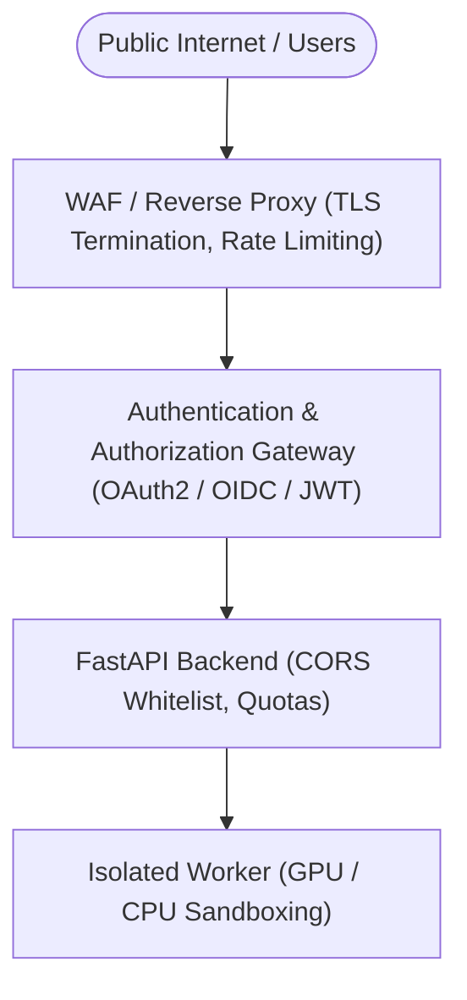

# CrowdDNA — Security & Deployment Assessment

**Document Version:** 1.0.0  
**Date:** November 14, 2026  
**Status:** Active Reference  

---

## 1. Executive Summary

This security and deployment assessment documents the current authentication, authorization, and network exposure profile of the CrowdDNA system (FastAPI backend and React frontend).

> [!WARNING]
> **DEPLOYMENT RESTRICTION:**
> CrowdDNA is currently architected exclusively for **local development and isolated internal network environments**. It **MUST NOT** be deployed directly to the public internet without the implementation of the security controls detailed in Section 3.

---

## 2. Current State Architecture & Threat Profile

### 2.1 Backend Authentication State
- **Stateless & Open:** All FastAPI HTTP endpoints (`/inference`, `/jobs/{job_id}`, `/jobs/{job_id}/video`, `/health`, `/version`) are unauthenticated.
- **No Token/Session Validation:** The backend does not inspect, validate, or require HTTP `Authorization` headers, API keys, or session cookies.
- **Client-Side Auth Mock:** The frontend includes an `AuthProvider` managing an in-memory / `localStorage` mock token. This mechanism provides no server-side security. Routes `/inference` and `/` (Dashboard) are publicly accessible to align with the backend's open state.

### 2.2 Network & CORS Posture
- **Configurable Origins:** Cross-Origin Resource Sharing (CORS) is managed through the `CROWDDNA_CORS_ORIGINS` environment variable.
  - **Default (Dev):** Whitelists `http://localhost:5173`, `http://127.0.0.1:5173`, `http://localhost:3000`, `http://127.0.0.1:3000`, `http://localhost:8000`, `http://127.0.0.1:8000`.
  - **Credentials:** Disabled (`allow_credentials=False`) to comply with the W3C Fetch specification and prevent unauthorized credential leakage.
- **Disallowed Origins:** Origins outside the configured whitelist are rejected with no CORS headers returned.

### 2.3 Upload & Resource Management
- **Size Enforcement:** Ingested videos are validated on upload with a strict 200 MB limit (`MAX_UPLOAD_SIZE_BYTES = 209,715,200` bytes). Chunks exceeding this limit trigger an immediate `HTTP 413 Payload Too Large`, and partial temporary files are deleted immediately.
- **Compute Concurrency:** Video inference jobs are managed via a thread-safe `JobManager` using a bounded worker pool (`ThreadPoolExecutor(max_workers=2)`).

---

## 3. Mandatory Security Requirements for Public Deployment

Before exposing CrowdDNA to untrusted networks or multi-tenant production use, the following hardening steps are mandatory:

1. **Server-Side Authentication & Authorization:**
   - Implement OAuth2 Bearer Tokens (JWT) or API Keys using FastAPI security dependencies (`HTTPBearer`, `OAuth2PasswordBearer`).
   - Introduce Role-Based Access Control (RBAC):
     - `Viewer`: Query job status, view dashboard telemetry, stream videos.
     - `Operator`: Submit inference jobs, cancel active jobs.
     - `Admin`: System health configuration, worker pool tuning.
2. **Reverse Proxy & TLS Termination:**
   - Deploy behind a production reverse proxy (e.g., NGINX, Traefik, or Cloudflare).
   - Enforce HTTPS and WSS (WebSocket Secure) with modern cipher suites and HSTS headers.
3. **Rate Limiting & DoS Mitigation:**
   - Integrate rate limiting (e.g., `slowapi` or Redis token bucket) on `POST /inference` (e.g., maximum 5 uploads per user per hour).
   - Limit concurrent running jobs per user/tenant to prevent GPU/CPU memory starvation.
4. **Storage & Retention Governance:**
   - Transition from temporary local disk storage (`tempfile`) to dedicated object storage (e.g., AWS S3, Google Cloud Storage, or MinIO) with signed pre-signed streaming URLs.
   - Configure automatic Lifecycle Rules (TTL) to purge uploaded and annotated video files after 24–72 hours.
5. **CORS Production Hardening:**
   - In production containers, set `CROWDDNA_CORS_ORIGINS` to the exact production frontend FQDN (e.g., `https://crowddna.myorganization.com`). Never use `*` in production.
