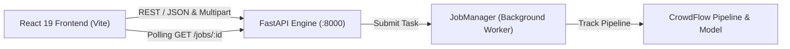

# CrowdDNA Frontend Dashboard & Telemetry Explorer

The CrowdDNA Web Frontend is a high-performance web interface for real-time pedestrian dynamics tracking, risk prediction telemetry, and spatial crowd risk estimation. Built with **React 19**, **TypeScript**, and **Vite**, it communicates asynchronously with the CrowdDNA FastAPI backend engine.

---

## Architecture & Integration Overview

The frontend connects directly to the CrowdDNA REST API (`crowdflow_dna.api.app`) to coordinate inference pipelines and visualize spatial telemetry:



### Key API Endpoints Used

| Endpoint | Method | Description |
| :--- | :--- | :--- |
| `/health` | `GET` | System heartbeat, timestamp, and version check |
| `/health/ready` | `GET` | Service readiness, model loading state, and compute device (`cuda:0` / `cpu`) |
| `/version` | `GET` | API specification and engine version metadata |
| `/inference` | `POST` | Asynchronous multipart video upload (`.mp4`, `.avi`) and job queuing |
| `/jobs/{job_id}` | `GET` | Lifecycle status polling and structured inference results retrieval |
| `/jobs/{job_id}` | `DELETE` | Cancellation of queued or in-flight inference jobs |

---

## Environment Configuration

Configuration is managed via Vite environment variables. Create a `.env` or `.env.local` file in the `frontend/` directory:

```bash
# Base URL pointing to the CrowdDNA FastAPI backend
VITE_API_BASE_URL=http://localhost:8000

# Optional feature flags
VITE_ENABLE_EXPLAINABILITY=true
```

| Variable | Default | Description |
| :--- | :--- | :--- |
| `VITE_API_BASE_URL` | `http://localhost:8000` | Target URL where FastAPI backend endpoints are hosted |
| `VITE_ENABLE_EXPLAINABILITY` | `false` | Enables GAT explainability and node-level attention visualizer |

---

## Getting Started

### Prerequisites

- **Node.js**: v18.0.0 or higher (v20+ recommended)
- **npm**: v9.0.0 or higher
- **Python**: v3.10+ (for running the backend service)

### 1. Installation

From the `frontend/` directory, install all dependencies:

```bash
cd frontend
npm install
```

### 2. Development Server Startup

Start the Vite development server with Hot Module Replacement (HMR):

```bash
npm run dev
```

The application is served at `http://localhost:5173`.

### 3. Production Build & Preview

Compile and optimize TypeScript and assets for production:

```bash
npm run build
```

Preview the production build locally:

```bash
npm run preview
```

### 4. Running the Test Suite

Execute the comprehensive Vitest test suite covering API client operations, file validations, job tracking, and dashboard rendering:

```bash
# Run all tests once
npm test

# Run tests in watch mode
npx vitest

# Run a specific test suite
npx vitest run tests/api.test.ts
npx vitest run tests/inference.test.tsx
npx vitest run tests/dashboard.test.tsx
```

---

## Local Full-Stack Integration Guide

Follow these steps to run the complete CrowdDNA application locally.

### Step 1: Start the FastAPI Backend

From the repository root (`CrowdDNA-Frontend`):

```bash
# Optional: Set deployment model path for real inference mode
# $env:CROWDDNA_MODEL_PATH = "configs/crowddna_weights.pt"

# Run FastAPI backend with Uvicorn
uvicorn crowdflow_dna.api.app:app --host 127.0.0.1 --port 8000 --reload
```

Verify backend health in your browser or terminal:
```bash
curl http://127.0.0.1:8000/health
# {"status":"healthy","timestamp":"2026-11-14T...","version":"1.0.0"}
```

### Step 2: Start the React Frontend

In a separate terminal:

```bash
cd frontend
npm run dev
```

Open `http://localhost:5173` in your browser.

### Step 3: Run an Inference Workflow

1. Navigate to the **Inference** page (`/inference`).
2. Select a surveillance video (`.mp4` or `.avi`).
3. Toggle **Ground-Plane Metric Calibration** if required.
4. Click **Submit Inference Job**.
5. The application enters the **Job Tracking** state, polling `GET /jobs/{job_id}` every 1.5 seconds until completion.
6. Once completed, click **View Results in Dashboard** to inspect:
   - Video stream metadata (Resolution, FPS, Total frames, Duration).
   - Interactive risk timeline scrubber (Safe, Congesting, Critical zones).
   - Spatial risk classifications per region.
   - Annotated output video playback and download.

---

## Docker & Container Integration

### Running with Docker Compose

To run both the backend API and frontend in isolated containers:

```yaml
version: '3.8'

services:
  backend:
    build:
      context: .
      dockerfile: Dockerfile
    command: uvicorn crowdflow_dna.api.app:app --host 0.0.0.0 --port 8000
    ports:
      - "8000:8000"
    environment:
      - CROWDDNA_MODEL_PATH=/models/crowddna.pt
    volumes:
      - ./data:/data

  frontend:
    build:
      context: ./frontend
      dockerfile: Dockerfile
    ports:
      - "5173:80"
    environment:
      - VITE_API_BASE_URL=http://localhost:8000
    depends_on:
      - backend
```

### Production Multi-Stage Dockerfile for Frontend

```dockerfile
# Build Stage
FROM node:20-alpine AS builder
WORKDIR /app
COPY package*.json ./
RUN npm ci
COPY . .
ARG VITE_API_BASE_URL=http://localhost:8000
ENV VITE_API_BASE_URL=$VITE_API_BASE_URL
RUN npm run build

# Serving Stage with Nginx
FROM nginx:alpine
COPY --from=builder /app/dist /usr/share/nginx/html
EXPOSE 80
CMD ["nginx", "-g", "daemon off;"]
```

---

## CORS & Network Configuration

FastAPI handles Cross-Origin Resource Sharing (CORS) through `CORSMiddleware` in `crowdflow_dna.api.app`:

- **Environment-Configurable Origins**: Controlled via the `CROWDDNA_CORS_ORIGINS` environment variable.
  - **Local Development Default**: `http://localhost:5173,http://127.0.0.1:5173,http://localhost:3000,http://127.0.0.1:3000,http://localhost:8000,http://127.0.0.1:8000`
  - **Production Whitelist Example**:
    ```bash
    export CROWDDNA_CORS_ORIGINS="https://crowddna.mycompany.com,https://analytics.mycompany.com"
    ```
- **Preflight Handling**: Responds to `OPTIONS` requests on `/health`, `/inference`, `/jobs/{job_id}`, and `/jobs/{job_id}/video` with `200 OK`.
- **Credentials**: Disabled (`allow_credentials=False`) to conform strictly to W3C Fetch security standards.
- **Allowed Headers**: `Authorization`, `Content-Type`, `Idempotency-Key`, and standard browser headers.
- **Allowed Methods**: `GET`, `POST`, `DELETE`, `OPTIONS`, `PUT`, `PATCH`.

Backend CORS behavior is verified continuously using `pytest tests/test_api_cors.py -v`.
